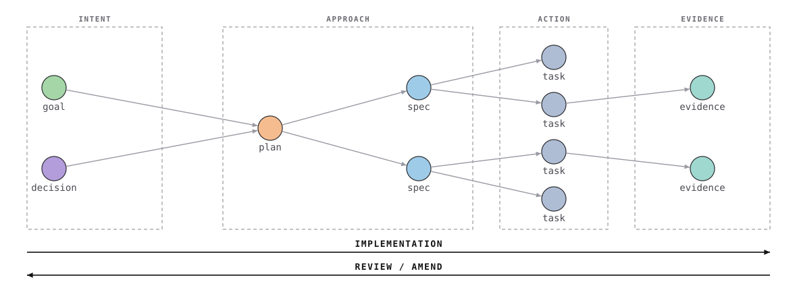

# brain

Everything that is **about** the work rather than part of it: the goals, the
decisions, the plans, the tracker and what you learned afterwards — as linked
markdown with YAML frontmatter, in Google's
[Open Knowledge Format](https://github.com/GoogleCloudPlatform/knowledge-catalog/tree/main/okf).

No database and no service. The files are the ground truth, which is what makes
them equally legible to a person, a diff and an agent.

<picture>
  <source media="(prefers-color-scheme: dark)" srcset="docs/lineage-dark.svg">
  
</picture>

## The one idea

**The record is only worth keeping if its claims are checkable.**

An absent note costs a reader nothing — they go and look. A confident, stale
note costs them the thing they would have found by looking, because they stop
looking. So the value of this is not how much it holds; it is the probability
that what it holds is true. Everything below exists to protect that probability
with a tool rather than with vigilance.

## The four categories

Every node is in exactly one, and they run left to right:

| Category | Types | Answers |
|---|---|---|
| **Intent** | `goal` `decision` `principle` | what we're trying to do, and what we've settled |
| **Approach** | `plan` `spec` | how we mean to do it |
| **Action** | `task` | what gets done |
| **Evidence** | `evidence` | what we observed, and what it corrects |

Two traversals, and both are a skill:

- **Implementation** runs forward. `/grill-change` interrogates a proposal
  against what's already decided, `/to-spec` and `/to-tasks` turn it into work,
  `/implement` builds it.
- **Review / amend** runs back. `/spec-review` walks from the shipped change to
  the intent that asked for it, asks whether it still serves that intent — and
  **amends what the build made false**, which is why the rail is one arrow and
  not two. The amend is the output of the review, not a separate journey.

Nodes carry an id: a type letter and four digits, flat and global. `G` goal,
`D` decision *and* principle, `P` plan, `S` spec, `T` task, `E` evidence.

**Nothing cites a node newer than itself.** A goal written today may cite
evidence an earlier effort produced; editing that earlier node to point at the
new goal is rewriting history. The linter checks it.

## Getting started

**Fork this repository.** Then install it one of two ways, and the difference
matters more than it looks.

### Embedded — the brain lives inside your repo (the default)

**Copy the files, do not clone.** A clone puts a `.git` inside the brain, and
your repo then tracks a *gitlink* it cannot resolve — one entry instead of
eighty files. Your knowledge would be invisible to the repo it is supposed to
be versioned with, which is the whole point of embedding it.

```bash
cd <project> && git init             # if it is not a repo yet; adopt requires one
git clone https://github.com/<you>/brain.git /tmp/brain-template
cp -R /tmp/brain-template <project>/brain
rm -rf <project>/brain/.git          # ← the important line
cd <project>/brain
bin/adopt                            # add --with-ci to install the workflow
```

`bin/doctor` fails if you skip the `rm -rf`, so you will not get this wrong
quietly.

**Keeping `example/` reserves the ids it holds**, so your first decision is
`D0010` rather than `D0001`. That is deliberate — the template's own record is
relocated, not deleted, and its ids are still in the tree, so reissuing them
would put two `D0001`s in one brain. `bin/adopt --bare` removes the example
and starts you at `D0001`.

**Updating later**: the brain splits into the generic half (`bin/`, `skills/`,
`hooks/`, `templates/`, `.github/`) and yours (`knowledge-catalog/`, `tasks/`,
`brief/`, `work/`, `config.md`). Upstream only ever changes the first, so an
update is re-copying the generic directories over the top — `bin/`, `skills/`,
`hooks/`, `docs/` and `.github/` — plus
`knowledge-catalog/reference/agent-skills/templates/`, which lives inside your
half of the tree but is ours. Everything else is yours. No remotes, no
subtree.

```bash
brain/bin/update --from https://github.com/<you>/brain.git
brain/bin/update --list        # exactly what counts as generic
```

It was a shell recipe here, and a recipe nobody runs rots: it pulled a clone
in `/tmp`, looped over directories only — so `INIT.md`, a top-level file,
never arrived — and the commit that introduced the hole edited this README in
five other places and left the recipe byte-identical. `bin/selftest` runs the
tool.

### Sibling — the brain is its own repo in a workspace

Here a clone is exactly right, because the brain **is** the repository:

```bash
cd <workspace>                       # holds the brain and your project repos
git clone https://github.com/<you>/brain.git brain
cd brain && bin/adopt --sibling
git remote add template https://github.com/hootener/brain.git   # for upstream fixes
```

### Then, either way

In the same session:

> read `brain/INIT.md` and follow it

A document rather than a skill, deliberately. Claude Code discovers skills when
a session *starts*, so one `bin/adopt` has just created cannot be called by the
session that ran it — and "restart Claude Code" is no instruction at all when
the reader *is* the session ([why this is a document and not a skill](knowledge-catalog/decisions/D0010-init-is-a-document.md)).

`bin/adopt` **installs** — links the skills so Claude Code can see them, stamps
the dates, records the layout, runs the checks. `INIT.md` **fills** — reads
your repository, imports the ADRs and glossary you already have, mines the
Claude transcript history for decisions nobody wrote down, and asks for the
first goal. They are separate because one is mechanical and one needs
judgement.

**It works on a project already in flight**, which is the case it is built for.
Everything imported lands as `status: draft` with a pointer to where it came
from, so you can see exactly how much is still reconstruction.

### Where to put it

**Embedded (`<repo>/brain/`) is the default**, because co-versioning is the
only thing that makes "this decision was true at this commit" checkable rather
than asserted. The decision and the code it governs move in one commit, and the
reviewer meets it in the pull request.

**Sibling** is fully supported and required in two cases you'll hit: you don't
control the repo (client work, a shared company project, an outside
contribution), or one brain serves several repos.

Sibling means a **workspace**: the brain and the project repos side by side in
a plain folder, and you run Claude Code from the folder.

```
workspace/
├── .claude/skills -> ../brain/skills
├── brain/                  # its own git repo — hooks and CI live here
└── acme-api/               # the project. Never written to.
```

**Nothing is written into the project repos.** Not `.claude/`, not `.github/`,
not `.git/hooks`. They're recorded in `config.md`'s `repos:` and read. That's
the entire reason to pick sibling — a shared repo stays clean, and nobody else
on it ever sees a file they didn't ask for.

The one cost, stated plainly: **start Claude Code in the workspace, not in the
project folder.** That's what keeps the project clean *and* what makes the
`brain/...` prefix every skill uses resolve. `bin/adopt` prints it on the way
out.

## So what do I actually type first?

**It depends on how clear the work is**, and picking wrong is cheap:

| You have | Start with |
|---|---|
| A clear idea of what to build | `/to-spec` |
| A proposal you want stress-tested first | `/grill-change` |
| Something too big or too foggy to spec | `/wayfinder` |
| A question about the project, not a change | `/interrogate` |

`/grill-change` on a brand-new brain will honestly tell you it's unexamined
ground, because it is. That's worth knowing but it isn't where the value is on
day one. **The value shows up the second time** — see below.

### Day one — building something

Say `INIT.md` gave you one goal: *a venue gets a usable quote in under a
minute* (`G0001`). You want to cache the rate lookup.

```
/to-spec
```

It asks the record first, resolves which goal this serves, and writes the
spec as `S0001`, with `serves:` pointing at the goal. If nothing
fits, it says so and writes the goal rather than inventing one to fill the
field.

```
/to-tasks
```

Cuts the spec into vertical slices, each with its blocking edges, each citing
the decisions it carries out. Then:

```console
$ brain/bin/status pricing
task                                             status                 waits on  title
pricing/T0001-cache-rate-lookups-for-the-life…   Ready for Development  -         Cache rate lookups for the life of a request
pricing/T0002-invalidate-the-cache-when-a-rate…  Ready for Development  T0001     Invalidate the cache when a rate changes

frontier (claimable now): pricing/T0001-cache-rate-lookups-for-the-life-of-a.md
```

Then `/implement`, which reads the lineage before writing a line:

```console
$ brain/bin/ancestry T0001
Ancestry of T0001-cache-rate-lookups-for-the-life-of-a.md
  4 document(s) upstream

  terminates at: G0001 A venue gets a usable quote in under a minute

  ── ACTION ──────────────────────────────────────────────
     What did neighbouring work establish that this depends on?

  T0001 Cache rate lookups for the life of a request
      brain/tasks/pricing/T0001-cache-rate-lookups-for-the-life-of-a.md  · Ready for Development

  ── APPROACH ────────────────────────────────────────────
     Did we take the route we said, or did it widen without being argued?

  S0001 Cache the rate lookup
      brain/knowledge-catalog/specs/S0001-cache-the-rate-lookup.md  · active  · via spec
      promises: Rate lookups repeat within a quote; cache them for the life of the request.

  ── INTENT ──────────────────────────────────────────────
     Is every claim here still true, and does the change still serve it?

  D0001 Prices come from the rate table, never from the model
      brain/knowledge-catalog/decisions/D0001-prices-come-from-the-rate-table.md  · active  · via link
      promises: Every figure in a proposal is looked up in the rate table; the model
                may phrase a price but never invent one.
```

That `terminates at:` line is the one to read. It means the work has a recorded
intent to be checked against. If it says `⚠ UNTERMINATED`, nothing upstream
explains why this is being built — which is a finding, not a formality.

Then `/spec-review`, which walks the same chain backwards, asks whether what
shipped still serves it, lists the upstream documents the build made false, and
moves the task to `Complete`.

### Three weeks later — where it pays back

Someone (possibly you, possibly an agent) proposes: *when no rate matches, let
the model estimate one so the quote still goes out.* Reasonable on its face,
and it serves the sixty-second goal.

```console
$ brain/bin/relevant "let the model estimate a price when the rate is missing"
Brain hits for: let the model estimate a price when the rate is missing
  matched on: let, model, estimate, price, rate, missing

  [decision] Prices come from the rate table, never from the model
      brain/knowledge-catalog/decisions/D0001-prices-come-from-the-rate-table.md  · active
      “- **Let the model infer a price from similar deals** — rejected: it produced
        confident figures with no basis, and a wrong price is worse than a slow one.”
```

The exact proposal, already rejected, with the reason — found in the
*Alternatives* section, which is where the reasoning usually lives. And because
the decision declared what it governs:

```console
$ brain/bin/constraints app/pricing/RateLookup.php
  D0001  Prices come from the rate table, never from the model
      brain/knowledge-catalog/decisions/D0001-prices-come-from-the-rate-table.md
      must hold: No price reaches a proposal without a matching rate-table row.
      matched:   app/pricing/RateLookup.php

  A change that contradicts one of these needs a recorded exit:
  amend the decision, or proceed against it with the id in the
  task's `# Log`. Noting it and moving on is not one of them.
```

`/grill-change` puts that to you with the path attached, so you can check it
rather than take its word. **Two exits, and "noted" isn't one**: amend `D0001`
on the record, or proceed against it with the id logged so the next reader
finds a deliberate exception instead of an accident.

That's the whole return on day one's bookkeeping — and it's why the first pass
feels like overhead and the second doesn't.

### Checking an initiative is actually finished

```console
$ brain/bin/ancestry G0001 --forward
  [task] T0001 Cache rate lookups for the life of a request  ← outstanding
  [task] T0002 Invalidate the cache when a rate changes  ← outstanding
  [spec] S0001 Cache the rate lookup
  [decision] D0001 Prices come from the rate table, never from the model

  2 of these are not done. An intent is complete when nothing
  it asked for is outstanding — omission, not drift, and a green
  test suite will not show it.
```

A reverse walk finds **drift** — building something subtly different from what
was asked. Only the forward walk finds **omission** — the spec nobody got to,
the task left at `Not Ready` while the initiative was called done. `/audit`
runs both and asks you about whatever it can't judge on its own.

## CI

Strongly recommended, and **opt-in** — `.github/` is your team's directory, so
`bin/adopt` describes the workflow and installs it only on `--with-ci`.

`bin/lint` and `bin/stale` are what keep the record honest between reviews, and
CI is the only place they run without somebody remembering to. The workflow
(`.github/workflows/brain.yml`) locates the brain itself, so one file works
embedded or sibling, and needs no setup step — every tool is stdlib Python 3.

| Step | Fails the build? |
|---|---|
| `bin/lint` | **yes** on errors; warnings never fail — an unresolved link is a valid marker of future work |
| `bin/stale` | **yes** — a countable claim contradicting the repo is a false statement a reader will meet |
| `bin/doctor` | **yes** — a broken install makes everything else meaningless |
| graph is current | **yes** — `graph.html` is generated *and committed*, so it drifts silently. `bin/graph-build --check` compares everything except the build stamp; a plain rebuild-and-diff would fail on every run, since each build stamps a fresh time into a single-line payload |
| decisions in force | no — printed to the run summary on a PR |
| `bin/selftest` | **yes** — a fresh install must be silent, and the foreign-content fixture must behave as designed |
| `bin/reconcile` | no — an ambiguous status is a question for a person |

> **Forking does not enable Actions.** GitHub disables workflows on a fork by
> default; open the Actions tab once and confirm.

## Skills

Thirteen, grouped by where they sit on the picture above.

**Forward — implementation**

| | |
|---|---|
| `/grill-change` | Interrogates a proposal against what the record already decided, measured and got wrong. Every challenge cites a path, so it's checkable rather than decision-shaped. A contradiction has two exits — amend the decision, or proceed against it with the id logged — and "noted" isn't one. |
| `/to-spec` | Turns the conversation into a spec. Resolves the goal it serves first, and if none fits, says so and writes the goal rather than inventing one to fill the field. |
| `/to-tasks` | Breaks a spec into tracer-bullet tasks with their blocking edges. Each task cites the decisions it carries out, which is the edge that makes the intent layer reachable at all. |
| `/implement` | Builds it — after reading the lineage and the constraints. Claims the task, journals as it goes, hands off at `Testing`. |

**Back — review and amend**

| | |
|---|---|
| `/spec-review` | The reverse walk. Checks the change still serves its intent, walks *forward* to catch what the intent asked for and nobody built, and produces the list of upstream documents the build made false. Owns `Testing → Complete`. |
| `/audit` | Reconciles a subgraph's statuses against what the repository shows, batches what's unambiguous, and asks about the rest — stating what it checked before it asks. Surfaces work done with no node at all. |

**Off the rails**

| | |
|---|---|
| `/interrogate` | The way *in*. Ask the brain a question and get an answer, not a tour — for an interviewer, a teammate, or you six weeks later asking why your own project is like this. |
| `/triage` | Moves tasks through the triage states and writes agent-ready briefs. |
| `/wayfinder` | For work too big to plan in one session: a map of decision tickets, resolved one at a time until the route is clear. Each resolution becomes a real decision node. |
| `/research` | Investigates against primary sources and files the findings as evidence — after checking whether the brain already answers the question. |
| `/domain-modeling` | Sharpens the glossary and the domain model as you design. |
| `/code-review` | The artifact, not the graph: correctness, security, performance, standards, as parallel sub-agents. Works in a repo with no brain. |
| `/handoff` | Builds a self-contained HTML page for whoever is picking the work up — designer, engineer, exec, analyst. Composes what the graph knows with a hand-written walkthrough. Never required. |

## Tools

```bash
bin/adopt                      # install into a project
bin/doctor                     # is the install sound
bin/lint                       # the gate: taxonomy, ids, links, direction, frontmatter
bin/status [initiative]        # task table and the claimable frontier
bin/relevant "<change>"        # what the record already says about a proposal
bin/constraints <paths>        # which decisions govern these files
bin/ancestry <id> [--claims]   # walk back to the intent that asked for it
bin/ancestry <id> --forward    # walk on to what that intent asked for
bin/reconcile [initiative]     # task status against the repository
bin/new <type> "<title>"       # allocate an id and scaffold the node
bin/renumber <old> <new>       # the one sanctioned reason to change an id
bin/relink                     # backticked citations of nodes become real links
bin/handoff <init> --for <who> # a self-contained HTML page for someone outside the brain
bin/stale                      # countable claims that no longer match the files
bin/index                      # rebuild every folder index from the nodes present
bin/utterances                 # what the operator actually said, from Claude Code's transcripts
bin/selftest                   # a fresh install, and a corpus not written for this brain
bin/graph-build                # rebuild graph.html
bin/diagram                    # rebuild the picture at the top of this file
```

No dependencies anywhere — stdlib Python 3.

## The graph

`bin/graph-build` writes `graph.html`: a browser-only force graph of every
markdown file here. Nodes are files, edges are the links between them. **Fill
is the node's `type`; the ring is its `status`.** Click a node for its metadata
and rendered contents.

The filter bar takes `#tag`, `@type` / `@status` and plain text, ANDed. Every
legend entry is clickable and carries a bracketed keyboard key. **Focus**
removes non-matching nodes, **linked** widens by one hop, `Esc` clears.

## Layout

| Directory | Holds | Lifecycle |
|---|---|---|
| `knowledge-catalog/` | goals, decisions, specs, evidence, glossary | keep — supersede, don't delete |
| `plans/` | how things get built | superseded by what shipped |
| `tasks/` | the tracker. One `task` file per ticket | churns |
| `work/` | per-worker journals, `<initiative>/<worker>.md` | kept while the initiative is open |
| `brief/` | source material the project answers, verbatim | fixed |
| `skills/` | the agent skills, symlinked into `.claude/skills` | generic — edit here |
| `bin/` | the tools above | — |
| `example/` | after `bin/adopt`: this template's own record, as a worked example | delete when you don't need it |
| `docs/` | generated diagrams the README embeds | rebuilt by `bin/diagram` |
| `hooks/` | the post-commit hook `bin/adopt` installs | generic — edit here |
| `feedback/` | raw inbound: transcripts, reports. **Not in git** | delete once the findings are written |

